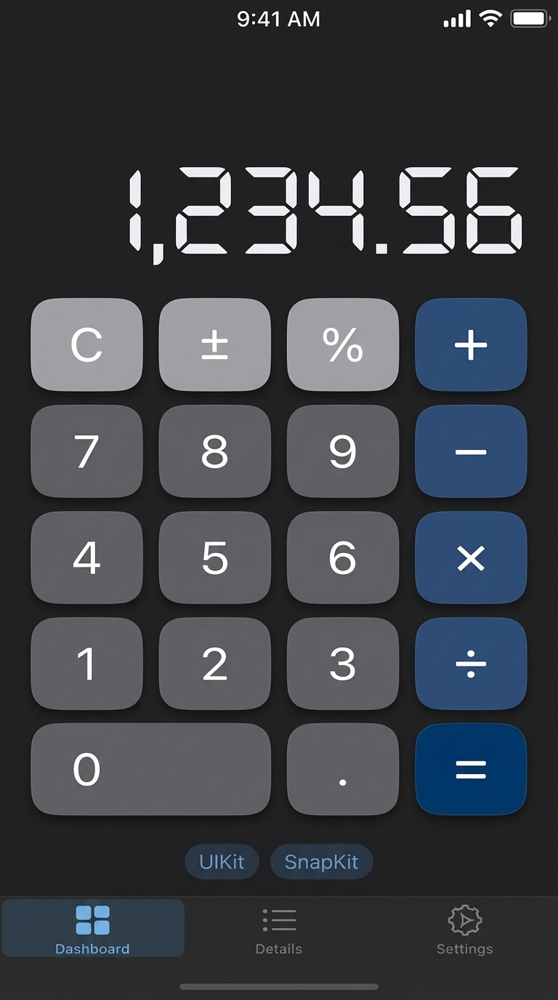
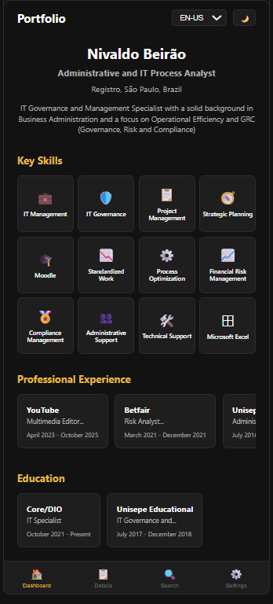
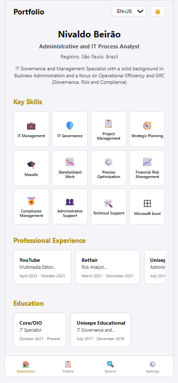

# Build Your Mobile Portfolio by Creating iOS Apps

Project developed during the Santander Bootcamp 2023 - Mobile iOS with Swift, under the guidance of specialist [Robson Moreira](https://github.com/robixnai "Robson Moreira"). 
In this lab project, you will gain hands-on experience with Apple's UI framework alongside its new reactive programming framework, Combine. You will develop three intuitive applications using these technologies and the MVVM design pattern. 
For this challenge, your task is to develop three applications in Xcode:

- The first project involves using Swift as the programming language, along with UIKit, Storyboard, XIBs, and ViewCode; you must use CocoaPods to manage at least one dependency, and the app must consist of at least three screens;

- For the second project, you must use SwiftUI, Combine, and a dependency managed by the Swift Package Manager (SPM);

- Finally, the third project explores the concept of modularization; you may choose between UIKit or SwiftUI and use CocoaPods to create the module, requiring at least one simple module and an app that utilizes it.

|  |  |

## Core Specifications

1. **Responsive Engine:** Implements a fluid CSS Grid layout architecture that scales natively without rigid framework layers.
2. **Accessibility First:** Formatted with clear accessibility semantics, including semantic document layouts and focus outlines.
3. **Dynamic Theming Architecture:**
    - Default State: **Dark Mode** (`🌙`).
    - Alternative State: **Light Mode** (`☀️`).
    - Driven purely via CSS custom properties decoupled from asset loads.
4. **Localization Matrix:** Orchestrated via JavaScript routers mapping real-time text updates seamlessly between **EN-US (Primary)**, **PT-BR**, and **ES** translation structures.

## Tecnologies used

- **HTML**: Structural interface mapping
- **CSS**: Adaptive properties & media-query rules
- **JavaScript**: Dark-mode toggle engine & language router

## Local Execution

- Clone the working ecosystem file track.
- Open `index.html` natively inside any modern browser engine.
- No compile steps or node package infrastructures are required.

[LICENSE](./LICENSE)
